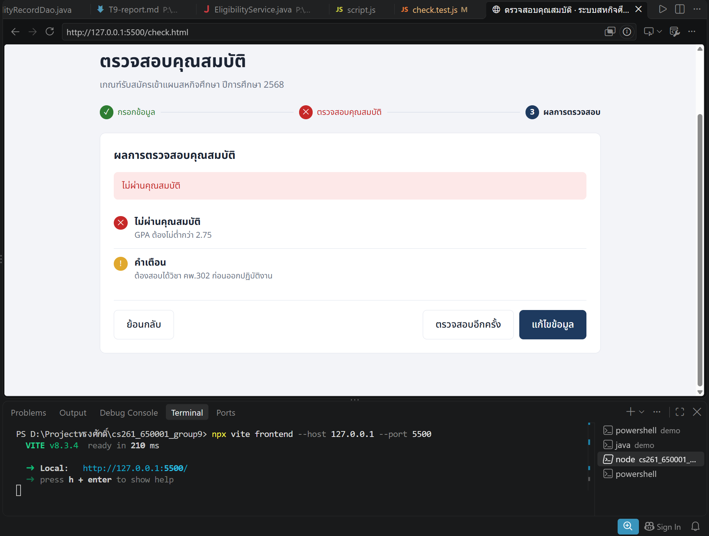
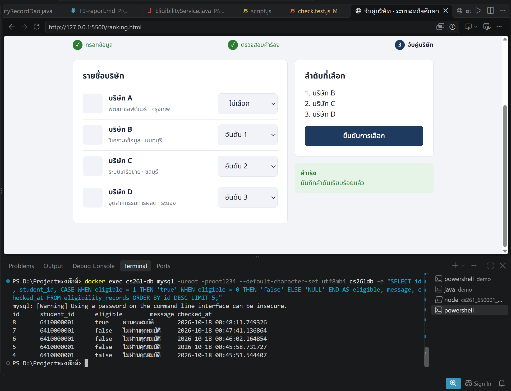

# U2:T10 Integration Test Report

## 1. วัตถุประสงค์

ทดสอบการทำงานร่วมกันของระบบตรวจสอบคุณสมบัตินักศึกษา ตั้งแต่หน้าเว็บส่งข้อมูลไปยัง REST API ประมวลผลเงื่อนไข บันทึกผลผ่าน DAO และจัดเก็บลงฐานข้อมูล MySQL

## 2. ส่วนประกอบที่เชื่อมต่อ

ลำดับการทำงานของระบบ:

1. ผู้ใช้กรอกข้อมูลผ่านหน้า UI
2. Frontend ส่ง HTTP POST Request ไปยัง API
3. EligibilityController รับ Request
4. EligibilityService ตรวจสอบข้อมูลและคุณสมบัติ
5. EligibilityRecordDao บันทึกผลการตรวจสอบ
6. MySQL จัดเก็บประวัติผลการตรวจสอบ
7. API ส่ง Response กลับไปแสดงบนหน้า UI

Endpoint ที่ใช้:

```text
POST /api/eligibility/check
```

## 3. เครื่องมือที่ใช้

- Java 21
- Spring Boot 4.1.1
- Spring Data JPA
- MySQL 8.4
- Docker
- JavaScript
- Vite
- PowerShell

## 4. Integration Test Cases

| ลำดับ | Test Case | ผลลัพธ์ที่คาดหวัง | ผลการทดสอบ |
|---|---|---|---|
| 1 | กรอกข้อมูลถูกต้องและ GPA 3.10 | UI แสดงว่าผ่านคุณสมบัติ และฐานข้อมูลบันทึก `eligible = true` | ผ่าน |
| 2 | กรอกข้อมูลถูกต้องแต่ GPA 2.74 | UI แสดงว่าไม่ผ่านคุณสมบัติ และฐานข้อมูลบันทึก `eligible = false` | ผ่าน |

## 5. ผลการทดสอบ

ระบบสามารถเชื่อมต่อการทำงานระหว่าง UI, REST API, Service, DAO และ MySQL ได้สำเร็จ

กรณี GPA ต่ำกว่า 2.75 หน้า UI แสดงข้อความไม่ผ่านคุณสมบัติและแสดงเหตุผลได้ถูกต้อง



ผลการตรวจสอบถูกบันทึกลงตาราง `eligibility_records` โดยพบทั้งกรณีผ่านและไม่ผ่านคุณสมบัติ



## 6. สรุปผล

ผลการทดสอบผ่านทั้ง 2 กรณี ระบบสามารถรับข้อมูลจากหน้า UI ส่งข้อมูลไปยัง API ประมวลผลผ่าน Service บันทึกผลผ่าน DAO ลงในฐานข้อมูล MySQL และแสดงผลตอบกลับบนหน้า UI ได้อย่างถูกต้อง

## การแก้ไขหลัง Review: เชื่อมผล U2 กับผู้ใช้ที่ Login และ U4

### ปัญหาที่พบ

ผลตรวจคุณสมบัติเคยถูกบันทึกให้รหัสนักศึกษาทดสอบ `6410000001`
แทนผู้ใช้ที่ Login จริง ทำให้นักศึกษา `6609650003` เข้าใช้งาน U4
แล้วได้รับ `403 NOT_ELIGIBLE`

### การแก้ไข

- Frontend ส่ง `X-User-Id` ของผู้ใช้ที่ Login ไปยัง Eligibility API
- API ค้นนักศึกษาจากตาราง `students` ด้วย `userId`
- ตรวจว่ารหัสนักศึกษาและ GPA ใน Request ตรงกับฐานข้อมูล
- บันทึกผลโดยใช้ `studentId` จากฐานข้อมูล ไม่เชื่อค่าจาก Request โดยตรง
- U4 ตรวจผลล่าสุดด้วย `studentId` ของนักศึกษาที่สัมพันธ์กับ `X-User-Id`

ลำดับการทำงานหลังแก้ไข:

```text
X-User-Id: 5
→ users.id = 5
→ students.user_id = 5
→ students.student_id = 6609650003
→ eligibility_records.student_id = 6609650003
→ U4 ตรวจผลล่าสุด eligible = true