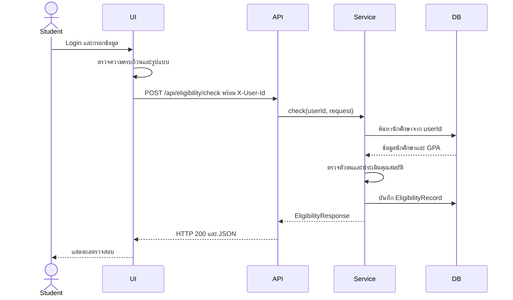
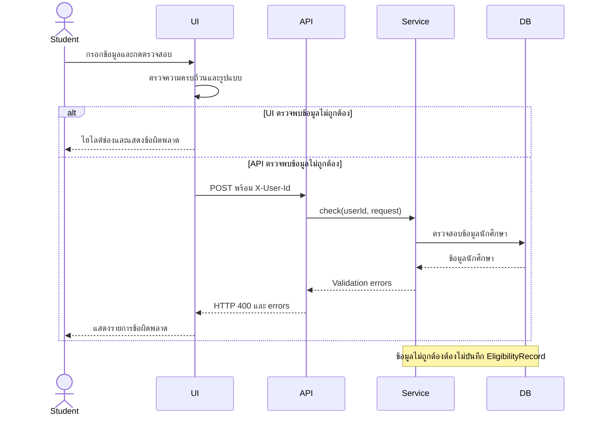

# U2:T15 Design System Test ตาม Sequence Diagram

## 1. วัตถุประสงค์

ออกแบบ System Test Cases สำหรับระบบตรวจสอบคุณสมบัติอัตโนมัติ โดยทดสอบตั้งแต่ผู้ใช้เข้าสู่ระบบ กรอกข้อมูลบน UI ส่งข้อมูลไปยัง API ตรวจสอบตัวตนและข้อมูลนักศึกษาจากฐานข้อมูล ประมวลผลผ่าน Service และบันทึกผลผ่าน DAO

การทดสอบใช้บัญชีนักศึกษาที่มีอยู่จริงในข้อมูลตัวอย่างของระบบ ได้แก่ `6609650001`

## 2. ข้อมูลบัญชีที่ใช้ทดสอบ

| รายการ | ค่า |
|---|---|
| Username | `6609650001` |
| Password สำหรับข้อมูลตัวอย่าง | `1234` |
| User ID | `3` |
| HTTP Header | `X-User-Id: 3` |
| Student ID | `6609650001` |
| หลักสูตร | `66` |
| GPA ในฐานข้อมูล | `3.10` |
| คณะ | วิทยาศาสตร์และเทคโนโลยี |
| สาขา | วิทยาการคอมพิวเตอร์ |

## 3. ส่วนประกอบของระบบ

- Student: นักศึกษาที่เข้าสู่ระบบ
- UI: หน้าตรวจสอบคุณสมบัติ
- API: `EligibilityController`
- Service: `EligibilityService`
- Student Repository: ใช้ตรวจสอบข้อมูลนักศึกษาจากฐานข้อมูล
- DAO: `EligibilityRecordDao`
- Database: MySQL

---

## 4. Sequence Diagram: ข้อมูลถูกต้อง

### SYS-SEQ-01: ข้อมูลถูกต้องและผ่านคุณสมบัติ

| รายการ | รายละเอียด |
|---|---|
| Test Case ID | SYS-SEQ-01 |
| Sequence Diagram | ข้อมูลถูกต้อง |
| Precondition | Backend, MySQL และ Frontend ทำงาน และมีข้อมูลนักศึกษา `6609650001` |
| Login | Username `6609650001`, Password `1234` |
| Identity | ระบบส่ง Header `X-User-Id: 3` |
| Input | หลักสูตร `66`, GPA `3.10`, เกรดรายวิชาบังคับทุกวิชาเป็น `B`, สถานะรายวิชาเป็น `กำลังศึกษา` และยืนยันครบ 3 ข้อ |
| ขั้นตอน | เข้าสู่ระบบ กรอกข้อมูลครบถ้วน และกดปุ่มตรวจสอบคุณสมบัติ |
| Expected API Result | HTTP `200 OK`, `valid = true`, `eligible = true`, `message = ผ่านคุณสมบัติ` |
| Expected UI Result | UI แสดงข้อความ `ผ่านคุณสมบัติ` และคำเตือนว่าต้องสอบได้วิชา คพ.301 ก่อนออกปฏิบัติงาน |
| Expected DAO Result | บันทึก `studentId = 6609650001` และ `eligible = true` จำนวน 1 รายการ |

### SYS-SEQ-02: ข้อมูลถูกต้องแต่ไม่ผ่านคุณสมบัติ

| รายการ | รายละเอียด |
|---|---|
| Test Case ID | SYS-SEQ-02 |
| Sequence Diagram | ข้อมูลถูกต้อง |
| Precondition | Backend, MySQL และ Frontend ทำงาน และมีข้อมูลนักศึกษา `6609650001` |
| Login | Username `6609650001`, Password `1234` |
| Identity | ระบบส่ง Header `X-User-Id: 3` |
| Input | หลักสูตร `66`, GPA `3.10` ตรงกับฐานข้อมูล แต่กำหนดเกรดวิชา `คพ.100` เป็น `C` ส่วนวิชาอื่นเป็น `B`, สถานะรายวิชาถูกต้อง และยืนยันครบ 3 ข้อ |
| ขั้นตอน | เข้าสู่ระบบ กรอกข้อมูลครบถ้วน และกดปุ่มตรวจสอบคุณสมบัติ |
| Expected API Result | HTTP `200 OK`, `valid = true`, `eligible = false`, `message = ไม่ผ่านคุณสมบัติ` |
| Expected Reason | `คพ.100 ต้องได้เกรด C+ ขึ้นไป` |
| Expected UI Result | UI แสดงข้อความ `ไม่ผ่านคุณสมบัติ` พร้อมเหตุผลของวิชา คพ.100 |
| Expected DAO Result | บันทึก `studentId = 6609650001` และ `eligible = false` จำนวน 1 รายการ |

---

## 5. Sequence Diagram: ข้อมูลไม่ถูกต้อง

### SYS-SEQ-03: กรอกข้อมูลไม่ครบ

| รายการ | รายละเอียด |
|---|---|
| Test Case ID | SYS-SEQ-03 |
| Sequence Diagram | ข้อมูลไม่ถูกต้อง |
| Precondition | Login ด้วยบัญชี `6609650001` และเปิดหน้าตรวจสอบคุณสมบัติ |
| Input | เว้น GPA หรือผลการเรียนรายวิชาบังคับให้ว่าง |
| ขั้นตอน | ยืนยันเงื่อนไขครบ 3 ข้อและพยายามกดตรวจสอบ |
| Expected UI Result | UI ไฮไลต์ช่องที่ผิดและแจ้งให้กรอกข้อมูลให้ครบถ้วน |
| Expected API Result | UI ไม่ส่ง Request ไปยัง API |
| Expected DAO Result | จำนวนข้อมูลใน `eligibility_records` ไม่เพิ่ม |

### SYS-SEQ-04: GPA ผิดรูปแบบ

| รายการ | รายละเอียด |
|---|---|
| Test Case ID | SYS-SEQ-04 |
| Sequence Diagram | ข้อมูลไม่ถูกต้อง |
| Precondition | Login ด้วยบัญชี `6609650001` และเปิดหน้าตรวจสอบคุณสมบัติ |
| Input | GPA เป็น `3.10abc` และข้อมูลอื่นกรอกครบ |
| ขั้นตอน | ยืนยันครบ 3 ข้อและพยายามกดตรวจสอบ |
| Expected UI Result | UI ไฮไลต์ช่อง GPA และแจ้งว่า GPA ต้องเป็นตัวเลข |
| Expected API Result | UI ไม่ส่ง Request ไปยัง API |
| Expected DAO Result | จำนวนข้อมูลใน `eligibility_records` ไม่เพิ่ม |

### SYS-SEQ-05: API ได้รับ Request ที่ข้อมูลไม่ครบ

| รายการ | รายละเอียด |
|---|---|
| Test Case ID | SYS-SEQ-05 |
| Sequence Diagram | ข้อมูลไม่ถูกต้อง |
| Precondition | Backend และ MySQL ทำงาน และมีนักศึกษา `6609650001` |
| Header | `X-User-Id: 3` |
| Input | JSON `{}` |
| ขั้นตอน | ส่ง POST ไปยัง `/api/eligibility/check` |
| Expected API Result | HTTP `400 Bad Request`, `valid = false`, `eligible = null` และมีรายการ `errors` |
| Expected DAO Result | Service ไม่บันทึกข้อมูล และจำนวนแถวไม่เพิ่ม |

### SYS-SEQ-06: API ได้รับ Request ที่ข้อมูลผิดรูปแบบ

| รายการ | รายละเอียด |
|---|---|
| Test Case ID | SYS-SEQ-06 |
| Sequence Diagram | ข้อมูลไม่ถูกต้อง |
| Precondition | Backend และ MySQL ทำงาน และมีนักศึกษา `6609650001` |
| Header | `X-User-Id: 3` |
| Input | `studentId = 6609650001`, `curriculum = 66`, `gpax = 3.10abc`, เกรดหรือสถานะไม่ถูกต้อง และมีรหัสวิชาที่ไม่อยู่ในหลักสูตร |
| ขั้นตอน | ส่ง POST ไปยัง `/api/eligibility/check` |
| Expected API Result | HTTP `400 Bad Request`, `valid = false` และมีข้อความระบุ GPA เกรด สถานะ หรือรหัสวิชาที่ไม่ถูกต้อง |
| Expected DAO Result | Service ไม่บันทึกข้อมูล และจำนวนแถวไม่เพิ่ม |

## 6. เกณฑ์การผ่าน

System Test ผ่านเมื่อ:

- ระบบโหลดรหัสนักศึกษาจากบัญชีที่เข้าสู่ระบบ
- UI ส่ง `X-User-Id: 3` ไปยัง API
- API ตรวจสอบผู้ใช้กับข้อมูลในตาราง `students`
- Student ID ที่ประเมินต้องเป็น `6609650001`
- GPA ใน Request ต้องตรงกับ GPA `3.10` ในฐานข้อมูล
- ระบบปฏิเสธรหัสวิชาที่ไม่อยู่ในหลักสูตร 66
- กรณีผ่านต้องบันทึก `eligible = true`
- กรณีไม่ผ่านต้องบันทึก `eligible = false`
- ข้อมูลไม่ครบหรือผิดรูปแบบต้องไม่ถูกบันทึก
- ผลการทดสอบต้องบันทึกให้รหัสนักศึกษาของบัญชีที่เข้าสู่ระบบเท่านั้น

## 7. สรุป

System Test จำนวน 6 กรณีครอบคลุมกรณีผ่านคุณสมบัติ ไม่ผ่านคุณสมบัติ ข้อมูลไม่ครบ ข้อมูลผิดรูปแบบ การตรวจสอบตัวตนด้วย `X-User-Id` และการบันทึกผลให้กับนักศึกษาที่เข้าสู่ระบบจริง

การทดสอบทั้งหมดใช้บัญชี `6609650001`, `X-User-Id: 3`, หลักสูตร `66` และ GPA `3.10` ซึ่งตรงกับข้อมูลในฐานข้อมูล
