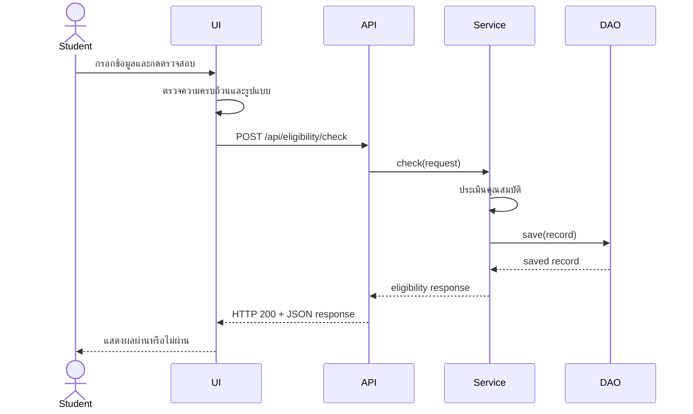
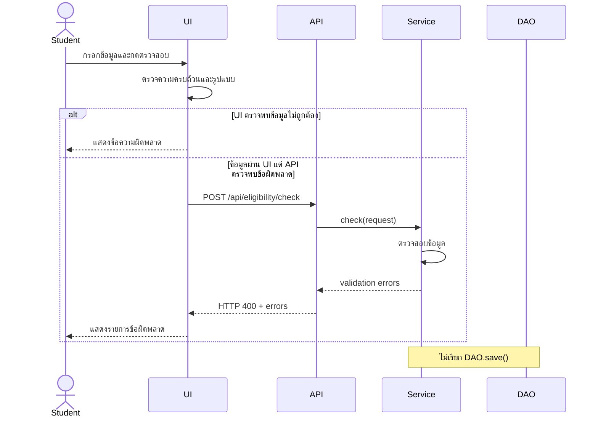

# U2:T15 Design System Test ตาม Sequence Diagram

## 1. วัตถุประสงค์

ออกแบบ System Test Cases ตามลำดับการทำงานของระบบตรวจสอบคุณสมบัติ ตั้งแต่ผู้ใช้กรอกข้อมูลบน UI ส่งข้อมูลไปยัง API ประมวลผลผ่าน Service และบันทึกผลผ่าน DAO

เนื่องจากไม่พบไฟล์ Sequence Diagram เดิมในโครงการ เอกสารนี้จึงกำหนด Sequence Diagram สำหรับ U2 และออกแบบ System Test Cases อ้างอิงตาม Diagram ดังกล่าว

## 2. ส่วนประกอบของระบบ

- Student: ผู้ใช้งานระบบ
- UI: หน้าเว็บตรวจสอบคุณสมบัติ
- API: EligibilityController
- Service: EligibilityService
- DAO: EligibilityRecordDao
- Database: MySQL ผ่านการทำงานของ DAO

---

## 3. Sequence Diagram: ข้อมูลถูกต้อง

### SYS-SEQ-01: ข้อมูลถูกต้องและผ่านคุณสมบัติ

| รายการ | รายละเอียด |
|---|---|
| Test Case ID | SYS-SEQ-01 |
| Sequence Diagram | ข้อมูลถูกต้อง |
| Precondition | Backend และ MySQL ทำงาน และเปิดหน้า `check.html` ได้ |
| Input | รหัสนักศึกษา `6410000001`, หลักสูตร `61`, GPA `3.10`, เกรดทุกวิชา `B`, สถานะวิชา `กำลังศึกษา`, ยืนยันครบ 3 ข้อ |
| ขั้นตอน | กรอกข้อมูลครบแล้วกดปุ่มตรวจสอบคุณสมบัติ |
| Expected API Result | HTTP `200 OK`, `valid = true`, `eligible = true`, `message = ผ่านคุณสมบัติ` |
| Expected UI Result | UI แสดงข้อความ `ผ่านคุณสมบัติ` |
| Expected DAO Result | บันทึกข้อมูล `studentId = 6410000001`, `eligible = true` จำนวน 1 รายการ |

### SYS-SEQ-02: ข้อมูลถูกต้องแต่ไม่ผ่านคุณสมบัติ

| รายการ | รายละเอียด |
|---|---|
| Test Case ID | SYS-SEQ-02 |
| Sequence Diagram | ข้อมูลถูกต้อง |
| Precondition | Backend และ MySQL ทำงาน และเปิดหน้า `check.html` ได้ |
| Input | ใช้ข้อมูลที่ถูกต้อง แต่กำหนด GPA เป็น `2.74` |
| ขั้นตอน | กรอกข้อมูลครบแล้วกดปุ่มตรวจสอบคุณสมบัติ |
| Expected API Result | HTTP `200 OK`, `valid = true`, `eligible = false`, เหตุผลมี `GPA ต้องไม่ต่ำกว่า 2.75` |
| Expected UI Result | UI แสดงข้อความ `ไม่ผ่านคุณสมบัติ` พร้อมเหตุผล |
| Expected DAO Result | บันทึกข้อมูล `studentId = 6410000001`, `eligible = false` จำนวน 1 รายการ |

---

## 4. Sequence Diagram: ข้อมูลไม่ถูกต้อง

### SYS-SEQ-03: กรอกข้อมูลไม่ครบ

| รายการ | รายละเอียด |
|---|---|
| Test Case ID | SYS-SEQ-03 |
| Sequence Diagram | ข้อมูลไม่ถูกต้อง |
| Precondition | เปิดหน้า `check.html` ได้ |
| Input | ไม่กรอกรหัสนักศึกษา และข้อมูลอื่นกรอกครบ |
| ขั้นตอน | กดปุ่มตรวจสอบคุณสมบัติ |
| Expected UI Result | UI แสดงข้อความ `กรอกข้อมูลให้ครบถ้วน` |
| Expected API Result | UI ไม่ส่ง Request ไปยัง API |
| Expected DAO Result | ไม่มีการบันทึกข้อมูล และจำนวนแถวในฐานข้อมูลไม่เพิ่ม |

### SYS-SEQ-04: กรอกข้อมูลผิดรูปแบบ

| รายการ | รายละเอียด |
|---|---|
| Test Case ID | SYS-SEQ-04 |
| Sequence Diagram | ข้อมูลไม่ถูกต้อง |
| Precondition | เปิดหน้า `check.html` ได้ |
| Input | GPA เป็น `3.10abc` |
| ขั้นตอน | กดปุ่มตรวจสอบคุณสมบัติ |
| Expected UI Result | UI แสดงข้อความว่า GPA ต้องเป็นตัวเลขระหว่าง 0.00–4.00 |
| Expected API Result | UI ไม่ส่ง Request ไปยัง API |
| Expected DAO Result | ไม่มีการบันทึกข้อมูล และจำนวนแถวในฐานข้อมูลไม่เพิ่ม |

### SYS-SEQ-05: API ได้รับ Request ที่ข้อมูลไม่ครบ

| รายการ | รายละเอียด |
|---|---|
| Test Case ID | SYS-SEQ-05 |
| Sequence Diagram | ข้อมูลไม่ถูกต้อง |
| Precondition | Backend และ MySQL ทำงาน |
| Input | JSON `{}` |
| ขั้นตอน | ส่ง POST Request ไปยัง `/api/eligibility/check` |
| Expected API Result | HTTP `400 Bad Request`, `valid = false`, `eligible = null`, มีรายการ `errors` |
| Expected DAO Result | Service ไม่เรียก `DAO.save()` และจำนวนแถวไม่เพิ่ม |

### SYS-SEQ-06: API ได้รับ Request ที่ข้อมูลผิดรูปแบบ

| รายการ | รายละเอียด |
|---|---|
| Test Case ID | SYS-SEQ-06 |
| Sequence Diagram | ข้อมูลไม่ถูกต้อง |
| Precondition | Backend และ MySQL ทำงาน |
| Input | `studentId = ABC123`, `gpax = 3.10abc`, เกรดหรือสถานะวิชาไม่ถูกต้อง |
| ขั้นตอน | ส่ง POST Request ไปยัง `/api/eligibility/check` |
| Expected API Result | HTTP `400 Bad Request`, `valid = false` และมีข้อความระบุข้อมูลที่ผิดรูปแบบ |
| Expected DAO Result | Service ไม่เรียก `DAO.save()` และจำนวนแถวไม่เพิ่ม |

## 5. เกณฑ์การผ่าน

System Test ผ่านเมื่อ:

- การทำงานเป็นไปตามลำดับที่กำหนดใน Sequence Diagram
- UI ส่ง Request ไปยัง API เมื่อข้อมูลมีรูปแบบถูกต้อง
- API ส่งผลการประเมินกลับไปแสดงบน UI ได้
- DAO บันทึกผลผ่านและไม่ผ่านได้ถูกต้อง
- ข้อมูลไม่ครบไม่ถูกบันทึกลงฐานข้อมูล
- ข้อมูลผิดรูปแบบไม่ถูกบันทึกลงฐานข้อมูล

## 6. สรุป

ออกแบบ System Test จำนวน 6 กรณีตาม Sequence Diagram 2 รูปแบบ ได้แก่ ข้อมูลถูกต้องและข้อมูลไม่ถูกต้อง ครอบคลุมกรณีผ่านคุณสมบัติ ไม่ผ่านคุณสมบัติ กรอกข้อมูลไม่ครบ และกรอกข้อมูลผิดรูปแบบ