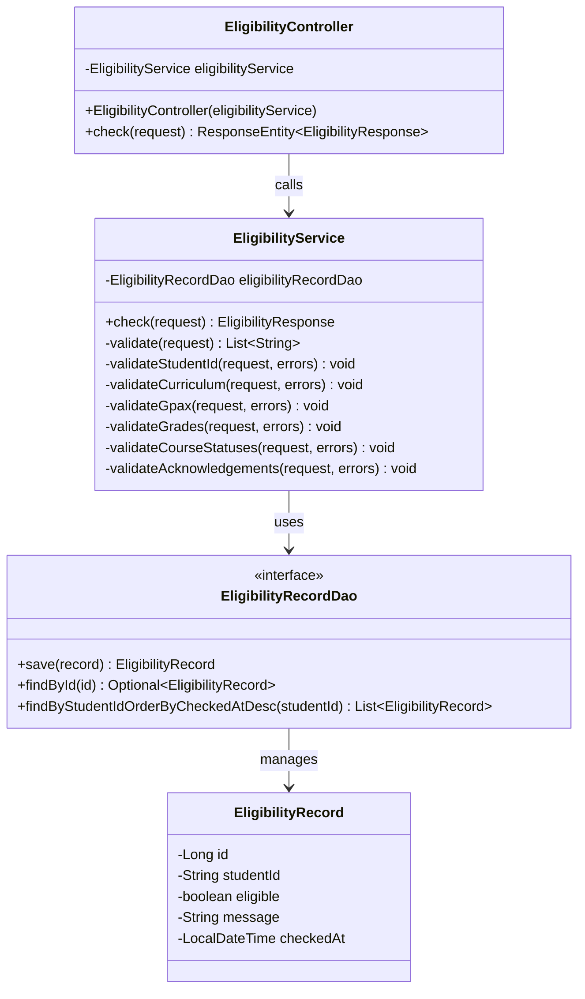
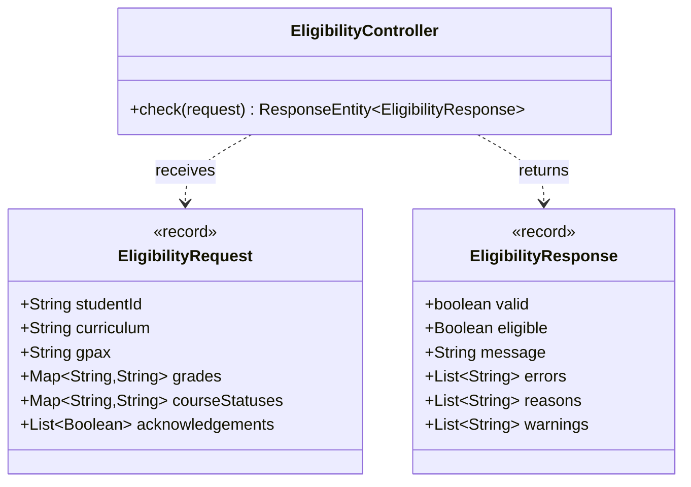

# U2:T5 ออกแบบ UI Prototype, DTO และ API

## 1. วัตถุประสงค์

ออกแบบหน้า UI, API Specification และโครงสร้าง DTO สำหรับระบบตรวจสอบคุณสมบัติอัตโนมัติ เพื่อใช้เป็นต้นแบบในการพัฒนาการรับข้อมูลจากนักศึกษา ส่งข้อมูลไปยัง Backend และแสดงผลการตรวจสอบอย่างถูกต้อง

## 2. ขอบเขตการออกแบบ

การออกแบบ U2:T5 ประกอบด้วย:

1. UI Prototype สำหรับกรอกข้อมูลและแสดงผล
2. API Specification สำหรับตรวจสอบคุณสมบัติ
3. API Class Diagram
4. DTO Class Diagram

---

## 3. UI Prototype

ไฟล์ต้นแบบ UI:

- [หน้า UI ตรวจสอบคุณสมบัติ](../../../frontend/check.html)
- [JavaScript ของหน้า UI](../../../frontend/js/script.js)

### 3.1 ข้อมูลที่ผู้ใช้ต้องกรอก

| ส่วน | ข้อมูล |
|---|---|
| ข้อมูลนักศึกษา | รหัสนักศึกษา คณะ สาขาวิชา และ GPA |
| หลักสูตร | หลักสูตร 61 หรือหลักสูตร 66 |
| ผลการเรียน | เกรดของรายวิชาบังคับ |
| สถานะรายวิชา | ยังไม่เคยลง กำลังศึกษา หรือเคยศึกษาแล้ว |
| การยืนยัน | ยืนยันเงื่อนไขจำนวน 3 ข้อ |

### 3.2 ส่วนประกอบของหน้า UI

| ส่วนประกอบ | หน้าที่ |
|---|---|
| ช่องรหัสนักศึกษา | รับรหัสนักศึกษา 10 หลัก |
| ช่อง GPA | รับค่า GPA ระหว่าง 0.00–4.00 |
| ตัวเลือกหลักสูตร | เลือกหลักสูตร 61 หรือ 66 |
| ตัวเลือกเกรด | ระบุเกรดของรายวิชาบังคับ |
| ตัวเลือกสถานะวิชา | ระบุสถานะการศึกษาของรายวิชา |
| Checkbox ยืนยัน | ยืนยันเงื่อนไขทั้ง 3 ข้อ |
| ปุ่มตรวจสอบ | ส่งข้อมูลไปตรวจสอบผ่าน API |
| ส่วนแสดงผล | แสดงผลผ่าน ไม่ผ่าน เหตุผล และคำเตือน |

### 3.3 พฤติกรรมของ UI

- ปุ่มตรวจสอบถูกปิดเมื่อยืนยันเงื่อนไขไม่ครบ
- UI ตรวจข้อมูลไม่ครบก่อนเรียก API
- UI ตรวจรูปแบบรหัสนักศึกษาและ GPA
- เมื่อข้อมูลผ่านการตรวจสอบเบื้องต้น UI ส่ง Request ไปยัง Backend
- UI แสดงผล `ผ่านคุณสมบัติ` หรือ `ไม่ผ่านคุณสมบัติ`
- หากไม่ผ่าน ระบบแสดงเหตุผล
- ระบบแสดงคำเตือนรายวิชาตามหลักสูตร
- หากเชื่อมต่อ Backend ไม่ได้ ระบบแสดงข้อความผิดพลาด

---

## 4. API Specification

### 4.1 ข้อมูลทั่วไป

| รายการ | รายละเอียด |
|---|---|
| API Name | Eligibility Check API |
| HTTP Method | `POST` |
| Endpoint | `/api/eligibility/check` |
| URL สำหรับพัฒนา | `http://localhost:8080/api/eligibility/check` |
| Content-Type | `application/json` |
| Request DTO | `EligibilityRequest` |
| Response DTO | `EligibilityResponse` |

### 4.2 Request Body

| Field | Type | Required | รายละเอียด |
|---|---|---:|---|
| `studentId` | String | Yes | รหัสนักศึกษาเป็นตัวเลข 10 หลัก |
| `curriculum` | String | Yes | หลักสูตร `61` หรือ `66` |
| `gpax` | String | Yes | GPA ระหว่าง 0.00–4.00 |
| `grades` | Map<String, String> | Yes | เกรดรายวิชาบังคับ |
| `courseStatuses` | Map<String, String> | Yes | สถานะรายวิชาที่เกี่ยวข้อง |
| `acknowledgements` | List<Boolean> | Yes | การยืนยันเงื่อนไขจำนวน 3 ข้อ |

### 4.3 ตัวอย่าง Request

```json
{
  "studentId": "6410000001",
  "curriculum": "61",
  "gpax": "3.10",
  "grades": {
    "คพ.101": "B",
    "คพ.102": "B",
    "คพ.111": "B",
    "คพ.213": "B",
    "คพ.251": "B",
    "คพ.264": "B"
  },
  "courseStatuses": {
    "คพ.384": "กำลังศึกษา",
    "คพ.266": "กำลังศึกษา"
  },
  "acknowledgements": [
    true,
    true,
    true
  ]
}
```

### 4.4 Response Body

| Field | Type | รายละเอียด |
|---|---|---|
| `valid` | boolean | ข้อมูล Request มีรูปแบบถูกต้องหรือไม่ |
| `eligible` | Boolean | ผลการประเมิน โดยเป็น `null` เมื่อข้อมูลไม่ถูกต้อง |
| `message` | String | ข้อความสรุปผล |
| `errors` | List<String> | รายการข้อมูลไม่ครบหรือผิดรูปแบบ |
| `reasons` | List<String> | เหตุผลที่ไม่ผ่านคุณสมบัติ |
| `warnings` | List<String> | คำเตือนเพิ่มเติมตามหลักสูตร |

### 4.5 HTTP Status

| HTTP Status | เงื่อนไข |
|---|---|
| `200 OK` | ข้อมูลมีรูปแบบถูกต้องและระบบประเมินผลสำเร็จ |
| `400 Bad Request` | ข้อมูลไม่ครบหรือผิดรูปแบบ |
| `500 Internal Server Error` | เกิดข้อผิดพลาดภายในระบบ |

### 4.6 ตัวอย่าง Response กรณีผ่าน

```json
{
  "valid": true,
  "eligible": true,
  "message": "ผ่านคุณสมบัติ",
  "errors": [],
  "reasons": [],
  "warnings": [
    "ต้องสอบได้วิชา คพ.302 ก่อนออกปฏิบัติงาน"
  ]
}
```

### 4.7 ตัวอย่าง Response กรณีไม่ผ่าน

```json
{
  "valid": true,
  "eligible": false,
  "message": "ไม่ผ่านคุณสมบัติ",
  "errors": [],
  "reasons": [
    "GPA ต้องไม่ต่ำกว่า 2.75"
  ],
  "warnings": [
    "ต้องสอบได้วิชา คพ.302 ก่อนออกปฏิบัติงาน"
  ]
}
```

### 4.8 ตัวอย่าง Response กรณีข้อมูลไม่ครบ

```json
{
  "valid": false,
  "eligible": null,
  "message": "ข้อมูลไม่ถูกต้อง",
  "errors": [
    "กรุณากรอกรหัสนักศึกษา",
    "กรุณากรอก GPA",
    "กรุณาส่งผลการเรียนรายวิชาบังคับ",
    "กรุณาส่งสถานะรายวิชาที่กำลังศึกษา หรือเคยศึกษา",
    "ต้องส่งข้อมูลการยืนยันให้ครบ 3 ข้อ"
  ],
  "reasons": [],
  "warnings": []
}
```

---

## 5. API Class Diagram



### คำอธิบาย API Class Diagram

- `EligibilityController` รับ HTTP Request จากหน้า UI
- Controller เรียก `EligibilityService.check()` เพื่อประเมินคุณสมบัติ
- `EligibilityService` ตรวจสอบข้อมูลและประเมินผล
- หากข้อมูลถูกต้อง Service เรียก `EligibilityRecordDao` เพื่อบันทึกผล
- `EligibilityRecordDao` จัดการข้อมูล `EligibilityRecord` ในฐานข้อมูล

---

## 6. DTO Class Diagram



### คำอธิบาย DTO

#### EligibilityRequest

ใช้รับข้อมูลจากหน้า UI ประกอบด้วย:

- รหัสนักศึกษา
- หลักสูตร
- GPA
- เกรดรายวิชา
- สถานะรายวิชา
- การยืนยันเงื่อนไข

ไฟล์:

`demo/src/main/java/com/example/demo/dto/EligibilityRequest.java`

#### EligibilityResponse

ใช้ส่งผลการประเมินกลับไปยังหน้า UI ประกอบด้วย:

- สถานะความถูกต้องของข้อมูล
- ผลผ่านหรือไม่ผ่าน
- ข้อความสรุป
- รายการข้อผิดพลาด
- เหตุผลที่ไม่ผ่าน
- คำเตือน

ไฟล์:

`demo/src/main/java/com/example/demo/dto/EligibilityResponse.java`

---

## 7. การเชื่อมต่อ UI กับ API

ลำดับการทำงานมีดังนี้:

1. นักศึกษากรอกข้อมูลบนหน้า `check.html`
2. JavaScript ตรวจสอบความครบถ้วนและรูปแบบเบื้องต้น
3. UI สร้างข้อมูลตามโครงสร้าง `EligibilityRequest`
4. UI ส่ง `POST /api/eligibility/check`
5. Controller รับ Request และส่งให้ Service
6. Service ตรวจสอบและประเมินคุณสมบัติ
7. Backend ส่ง `EligibilityResponse` กลับ
8. UI แสดงผลผ่าน ไม่ผ่าน เหตุผล หรือข้อผิดพลาด

## 8. ไฟล์ที่เกี่ยวข้อง

- [UI Prototype](../../../frontend/check.html)
- [JavaScript](../../../frontend/js/script.js)
- [EligibilityController](../../../demo/src/main/java/com/example/demo/controller/EligibilityController.java)
- [EligibilityService](../../../demo/src/main/java/com/example/demo/service/EligibilityService.java)
- [EligibilityRequest](../../../demo/src/main/java/com/example/demo/dto/EligibilityRequest.java)
- [EligibilityResponse](../../../demo/src/main/java/com/example/demo/dto/EligibilityResponse.java)
- [EligibilityRecordDao](../../../demo/src/main/java/com/example/demo/dao/EligibilityRecordDao.java)
- [EligibilityRecord](../../../demo/src/main/java/com/example/demo/entity/EligibilityRecord.java)

## 9. สรุป

U2:T5 ได้ออกแบบ UI Prototype, API Specification, API Class Diagram และ DTO Class Diagram สำหรับระบบตรวจสอบคุณสมบัติอัตโนมัติครบถ้วน

การออกแบบกำหนดให้ UI ส่งข้อมูลด้วย HTTP `POST` ไปยัง `/api/eligibility/check` โดยใช้ `EligibilityRequest` และรับผลกลับเป็น `EligibilityResponse` ซึ่งรองรับทั้งกรณีผ่าน ไม่ผ่าน ข้อมูลไม่ครบ และข้อมูลผิดรูปแบบ