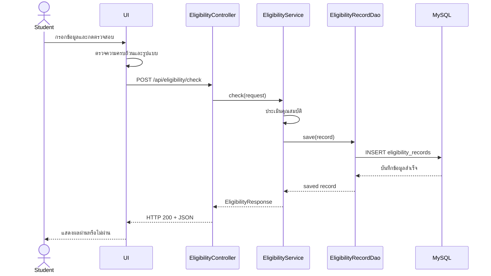
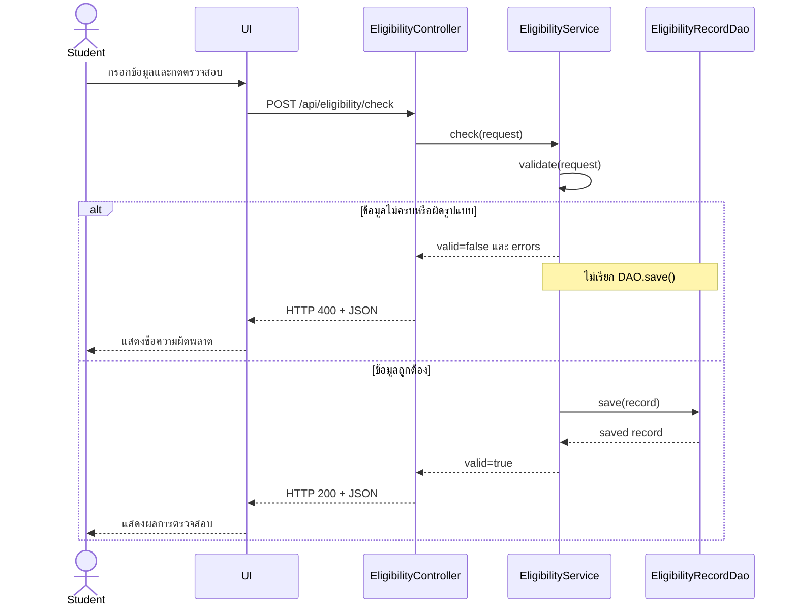
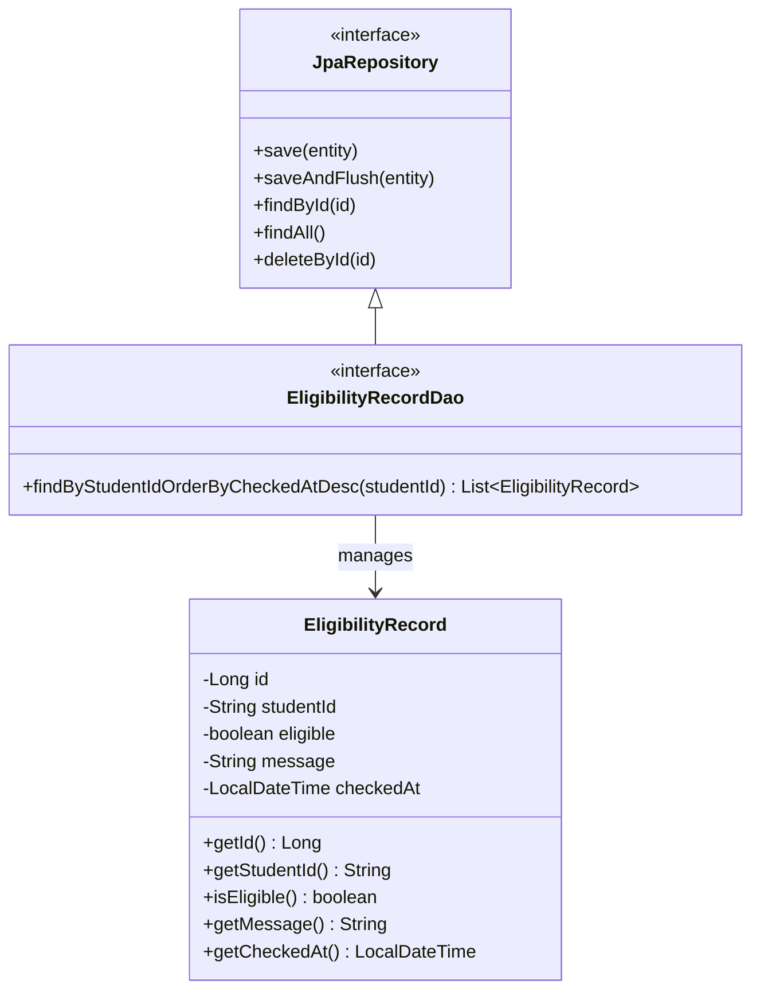
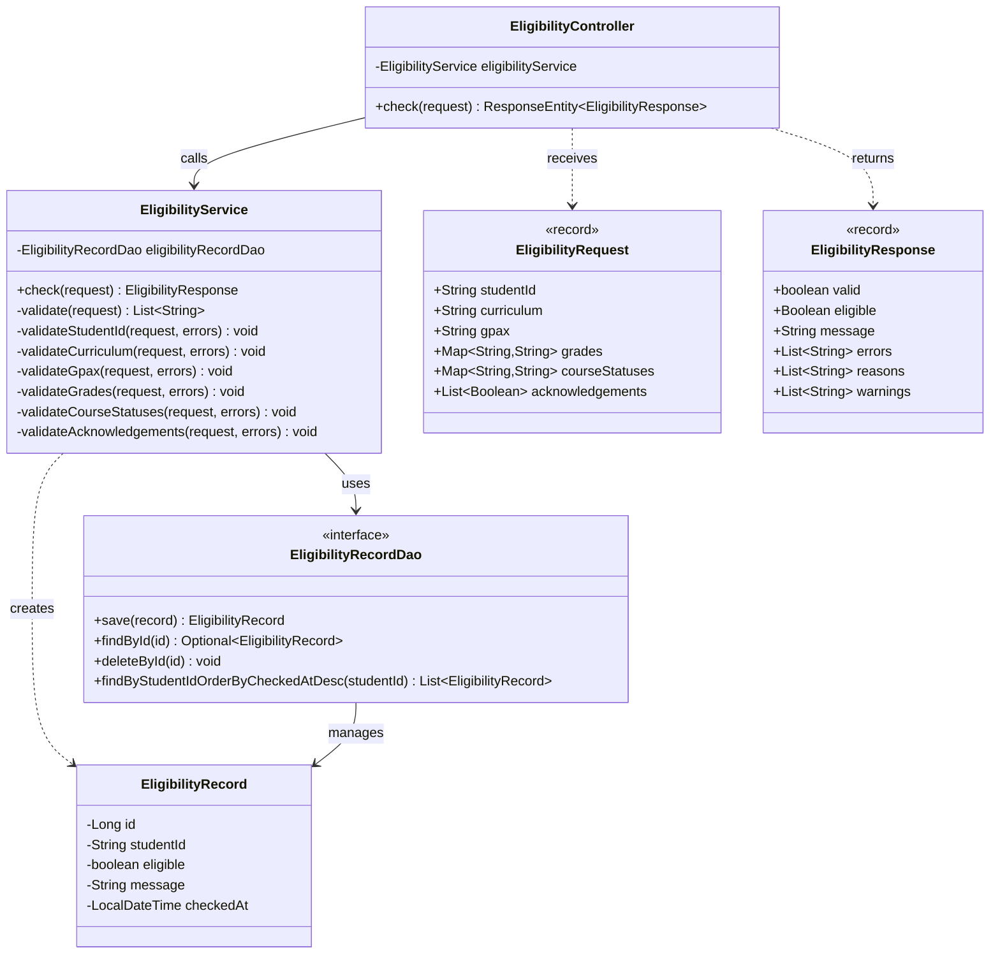
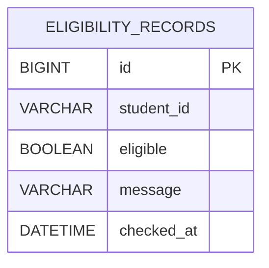

# U2:T6 Design Interaction ระหว่าง API–DAO–DB

## 1. วัตถุประสงค์

ออกแบบลำดับการทำงานและการเชื่อมต่อระหว่าง API, Service, DAO และฐานข้อมูลของระบบตรวจสอบคุณสมบัติอัตโนมัติ เพื่อให้ระบบสามารถรับข้อมูล ตรวจสอบคุณสมบัติ บันทึกผล และส่งผลลัพธ์กลับไปยังหน้า UI ได้อย่างถูกต้อง

## 2. ส่วนประกอบของระบบ

| ส่วนประกอบ | หน้าที่ |
|---|---|
| UI | รับข้อมูลนักศึกษาและแสดงผลการตรวจสอบ |
| `EligibilityController` | รับ HTTP Request และส่ง HTTP Response |
| `EligibilityService` | ตรวจสอบข้อมูลและประเมินคุณสมบัติ |
| `EligibilityRecordDao` | บันทึก ค้นหา และลบผลการตรวจสอบ |
| `EligibilityRecord` | Entity สำหรับจัดเก็บผลการตรวจสอบ |
| MySQL | ฐานข้อมูลสำหรับเก็บประวัติการตรวจสอบ |

---

## 3. Sequence Diagram

### 3.1 กรณีข้อมูลถูกต้อง



### 3.2 กรณีข้อมูลไม่ครบหรือผิดรูปแบบ



### คำอธิบาย Sequence Diagram

1. นักศึกษากรอกข้อมูลผ่านหน้า UI
2. UI ตรวจสอบความครบถ้วนและรูปแบบเบื้องต้น
3. UI ส่งข้อมูลด้วย `POST /api/eligibility/check`
4. Controller ส่ง Request ให้ Service
5. Service ตรวจสอบข้อมูลและประเมินคุณสมบัติ
6. หากข้อมูลถูกต้อง Service เรียก DAO เพื่อบันทึกผล
7. DAO บันทึกข้อมูลลง MySQL
8. API ส่งผลกลับให้ UI แสดงต่อผู้ใช้
9. หากข้อมูลไม่ครบหรือผิดรูปแบบ ระบบส่ง HTTP 400 และไม่บันทึกข้อมูล

---

## 4. DAO Class Diagram



### คำอธิบาย DAO Class Diagram

`EligibilityRecordDao` เป็น Interface ที่สืบทอดจาก `JpaRepository` จึงสามารถใช้งานคำสั่งพื้นฐานได้ เช่น:

- `save()` สำหรับบันทึกข้อมูล
- `saveAndFlush()` สำหรับบันทึกและส่งข้อมูลไปยังฐานข้อมูลทันที
- `findById()` สำหรับค้นหาข้อมูลด้วย ID
- `findAll()` สำหรับอ่านข้อมูลทั้งหมด
- `deleteById()` สำหรับลบข้อมูลด้วย ID

DAO มีเมธอดเพิ่มเติม:

```java
findByStudentIdOrderByCheckedAtDesc(String studentId)
```

ใช้ค้นหาประวัติการตรวจสอบของนักศึกษาด้วยรหัสนักศึกษา และเรียงรายการจากเวลาล่าสุดไปยังรายการเก่าสุด

---

## 5. Extended API Class Diagram



### คำอธิบาย Extended API Class Diagram

- `EligibilityController` รับ Request จาก UI
- `EligibilityRequest` เก็บข้อมูลที่ส่งมาจากผู้ใช้
- `EligibilityService` ตรวจสอบข้อมูลและประเมินคุณสมบัติ
- `EligibilityRecordDao` รับผิดชอบการติดต่อฐานข้อมูล
- `EligibilityRecord` แทนข้อมูลหนึ่งรายการในฐานข้อมูล
- `EligibilityResponse` เก็บผลลัพธ์ที่ส่งกลับไปยัง UI

---

## 6. API Specification

| รายการ | รายละเอียด |
|---|---|
| HTTP Method | `POST` |
| Endpoint | `/api/eligibility/check` |
| Content-Type | `application/json` |
| Request DTO | `EligibilityRequest` |
| Response DTO | `EligibilityResponse` |
| HTTP 200 | ข้อมูลถูกต้องและประเมินผลสำเร็จ |
| HTTP 400 | ข้อมูลไม่ครบหรือผิดรูปแบบ |

### ตัวอย่าง Request

```json
{
  "studentId": "6410000001",
  "curriculum": "61",
  "gpax": "3.10",
  "grades": {
    "คพ.101": "B",
    "คพ.102": "B",
    "คพ.111": "B",
    "คพ.213": "B",
    "คพ.251": "B",
    "คพ.264": "B"
  },
  "courseStatuses": {
    "คพ.384": "กำลังศึกษา",
    "คพ.266": "กำลังศึกษา"
  },
  "acknowledgements": [
    true,
    true,
    true
  ]
}
```

### ตัวอย่าง Response กรณีผ่านคุณสมบัติ

```json
{
  "valid": true,
  "eligible": true,
  "message": "ผ่านคุณสมบัติ",
  "errors": [],
  "reasons": [],
  "warnings": [
    "ต้องสอบได้วิชา คพ.302 ก่อนออกปฏิบัติงาน"
  ]
}
```

### ตัวอย่าง Response กรณีข้อมูลไม่ถูกต้อง

```json
{
  "valid": false,
  "eligible": null,
  "message": "ข้อมูลไม่ถูกต้อง",
  "errors": [
    "กรุณากรอกรหัสนักศึกษา",
    "กรุณากรอก GPA"
  ],
  "reasons": [],
  "warnings": []
}
```

---

## 7. ER Diagram



### คำอธิบาย ER Diagram

ระบบใช้ตาราง `eligibility_records` สำหรับจัดเก็บผลการตรวจสอบคุณสมบัติแต่ละครั้ง โดยหนึ่งแถวแทนผลการตรวจสอบหนึ่งรายการ

ระบบปัจจุบันยังไม่มี Entity สำหรับข้อมูลนักศึกษาโดยตรง จึงไม่สร้างความสัมพันธ์กับตารางนักศึกษาเพิ่มเติม เพื่อให้ ER Diagram ตรงกับ Entity และฐานข้อมูลที่ใช้งานจริง

---

## 8. Data Dictionary

| Column | Data Type | Constraint | รายละเอียด |
|---|---|---|---|
| `id` | `BIGINT` | Primary Key, Auto Increment | หมายเลขประจำรายการ |
| `student_id` | `VARCHAR(10)` | Not Null | รหัสนักศึกษา |
| `eligible` | `BOOLEAN` | Not Null | ผลการตรวจสอบว่าผ่านหรือไม่ผ่าน |
| `message` | `VARCHAR(255)` | Not Null | ข้อความสรุปผล |
| `checked_at` | `DATETIME` | Not Null | วันและเวลาที่ตรวจสอบ |

---

## 9. ลำดับการบันทึกข้อมูล

1. UI ส่งข้อมูลไปยัง `POST /api/eligibility/check`
2. `EligibilityController` รับข้อมูลเป็น `EligibilityRequest`
3. Controller เรียก `EligibilityService.check()`
4. Service ตรวจสอบความครบถ้วนและรูปแบบข้อมูล
5. ถ้าข้อมูลไม่ถูกต้อง ระบบส่ง HTTP 400 และไม่บันทึกลงฐานข้อมูล
6. ถ้าข้อมูลถูกต้อง Service ประเมินว่าผ่านหรือไม่ผ่าน
7. Service สร้าง `EligibilityRecord`
8. `EligibilityRecordDao` บันทึกข้อมูลลง MySQL
9. Service สร้าง `EligibilityResponse`
10. Controller ส่ง HTTP 200 พร้อมผลลัพธ์กลับไปยัง UI
11. UI แสดงผลให้ผู้ใช้ทราบ

## 10. สรุป

การออกแบบ U2:T6 ครอบคลุม Artifact ทั้งหมด 4 รายการ ได้แก่:

1. Sequence Diagram
2. DAO Class Diagram
3. Extended API Class Diagram
4. ER Diagram

การออกแบบแสดงให้เห็นลำดับการทำงานตั้งแต่หน้า UI ส่งข้อมูลไปยัง API การประมวลผลผ่าน Service การบันทึกผลผ่าน DAO ลงในฐานข้อมูล MySQL และการส่งผลลัพธ์กลับไปแสดงบนหน้า UI

กรณีข้อมูลไม่ครบหรือผิดรูปแบบ ระบบจะส่งข้อผิดพลาดกลับโดยไม่บันทึกข้อมูลลงฐานข้อมูล ซึ่งช่วยป้องกันการจัดเก็บข้อมูลที่ไม่ถูกต้อง