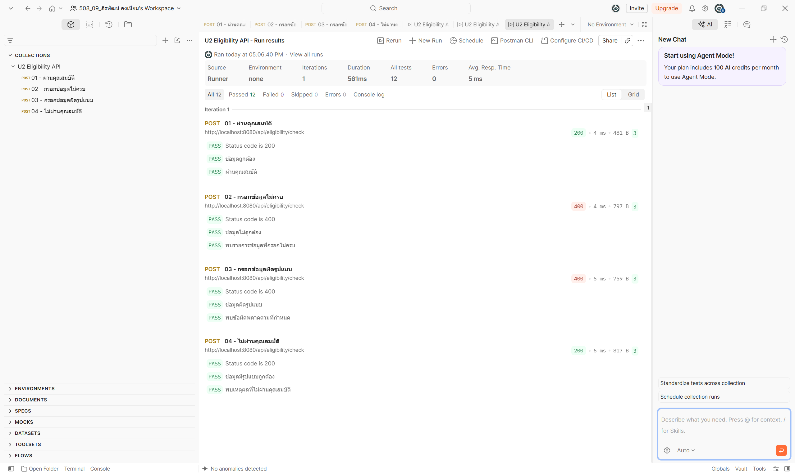
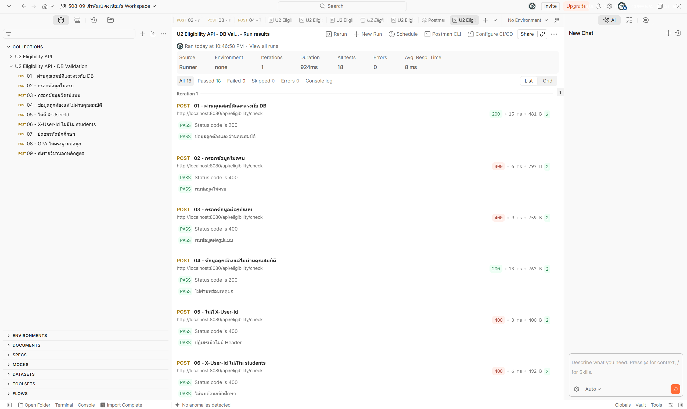
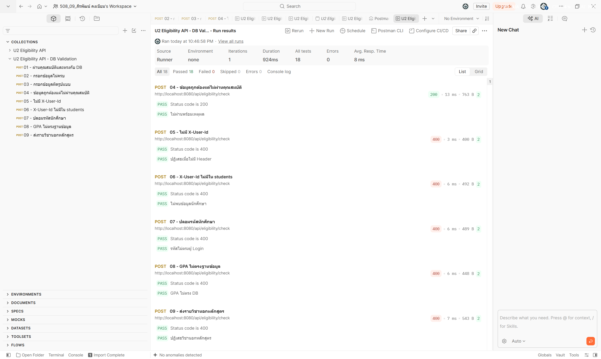

# U2:T8 Postman Collection and Test Report

## 1. วัตถุประสงค์

ทดสอบ API สำหรับตรวจสอบคุณสมบัติของนักศึกษาก่อนยื่นคำร้องฝึกงานหรือสหกิจศึกษา โดยใช้ Postman และจัดเก็บชุดทดสอบเป็น Postman Collection

## 2. API ที่ทดสอบ

- Method: `POST`
- URL: `http://localhost:8080/api/eligibility/check`
- Content-Type: `application/json`

## 3. รายการ Test Case

| ลำดับ | Test Case | Expected Status | Expected Result |
|---|---|---:|---|
| 1 | ผ่านคุณสมบัติ | 200 | `valid = true`, `eligible = true` |
| 2 | กรอกข้อมูลไม่ครบ | 400 | `valid = false`, `eligible = null` และมีข้อความแจ้งข้อมูลที่ขาด |
| 3 | กรอกข้อมูลผิดรูปแบบ | 400 | `valid = false`, `eligible = null` และมีข้อความแจ้งรูปแบบข้อมูลที่ผิด |
| 4 | ไม่ผ่านคุณสมบัติ | 200 | `valid = true`, `eligible = false` และมีเหตุผลที่ไม่ผ่าน |

## 4. Automated Tests ใน Postman

แต่ละ Request ตรวจสอบรายการต่อไปนี้:

1. HTTP Status Code ถูกต้อง
2. ค่า `valid` และ `eligible` ถูกต้องตามกรณีทดสอบ
3. Response มีข้อความหรือรายการข้อผิดพลาดตามที่กำหนด

## 5. ผลการทดสอบ

ผลการรัน Collection Runner:

- จำนวน Request: 4
- จำนวน Test ทั้งหมด: 12
- Passed: 12
- Failed: 0
- Errors: 0

สรุปผล: API ทำงานถูกต้องตาม Test Case ทั้ง 4 กรณี

## 6. หลักฐานผลการทดสอบ

## 7. ไฟล์ที่เกี่ยวข้อง

- Postman Collection: [`postman/U2-Eligibility-API.postman_collection.json`](postman/U2-Eligibility-API.postman_collection.json)
- Test Evidence: [`evidence/T8-postman-run.png`](evidence/T8-postman-run.png)

## หลักฐานการทดสอบหลังแก้ไข

รัน Postman Collection จำนวน 9 Requests รวม 18 Tests โดยมีผลดังนี้:

- Passed: 18
- Failed: 0
- Errors: 0
- กรณีที่ครอบคลุม:
  - ข้อมูลถูกต้องและตรงกับฐานข้อมูล
  - กรอกข้อมูลไม่ครบ
  - กรอกข้อมูลผิดรูปแบบ
  - ข้อมูลถูกต้องแต่ไม่ผ่านคุณสมบัติ
  - ไม่มี `X-User-Id`
  - `X-User-Id` ไม่มีอยู่ในตาราง `students`
  - ปลอมรหัสนักศึกษา
  - GPA ไม่ตรงกับฐานข้อมูล
  - ส่งรหัสวิชานอกหลักสูตร

