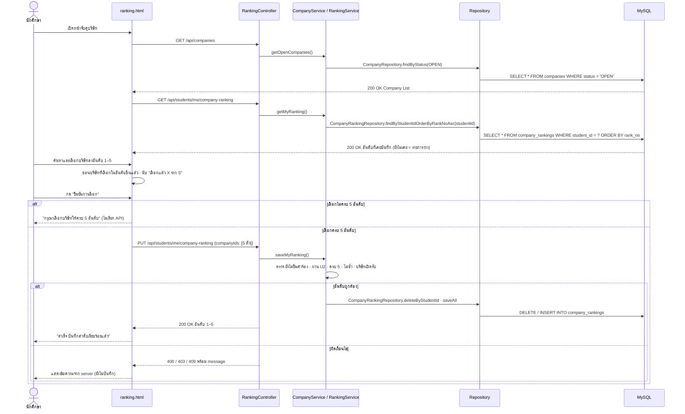
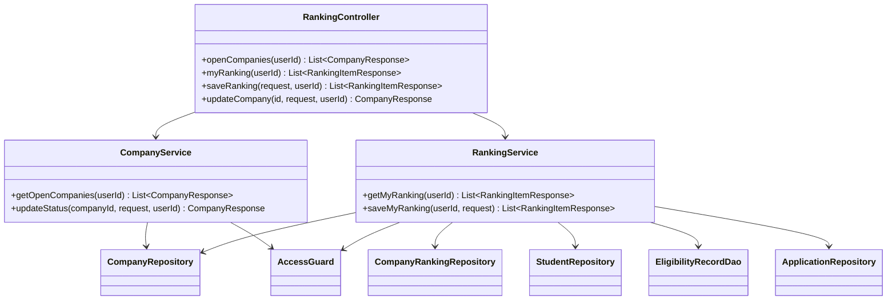
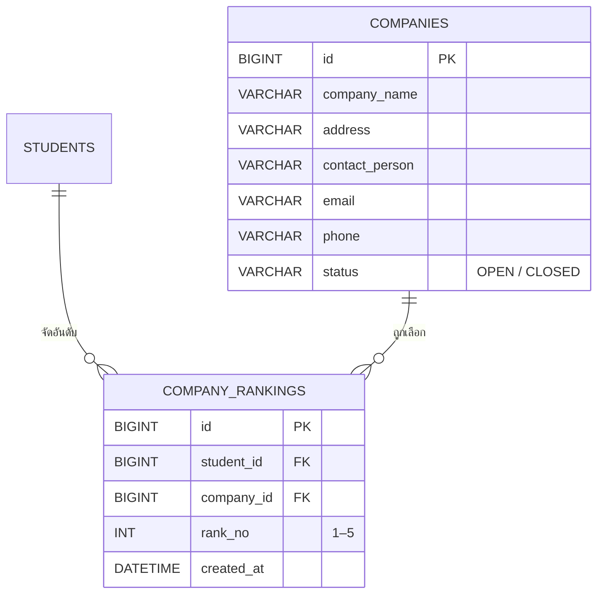

U4:T6 : ออกแบบ Interaction ระหว่าง API–DAO–DB (ระบบจับคู่บริษัท (จัดอันดับ))
-
ออกแบบลำดับการทำงานและการเชื่อมต่อระหว่าง API, DAO (Data Access Object) และฐานข้อมูลของระบบจับคู่บริษัท (จัดอันดับ) เพื่อให้ดึง/บันทึกข้อมูลได้ถูกต้อง
-

ส่วนประกอบของระบบ
-
Controller → Service / Business Logic → DAO / Repository → Entity / ORM → Database

| ส่วนประกอบ | หน้าที่ |
|---|---|
| UI (`ranking.html`) | แสดงช่องอันดับ 1–5 ให้นักศึกษาค้นหาบริษัทที่เปิดรับ จัดอันดับ และยืนยัน |
| `RankingController` | `GET /api/companies`, `GET /api/students/me/company-ranking`, `PUT /api/students/me/company-ranking` |
| `CompanyService` | ดึงบริษัทที่เปิดรับ |
| `RankingService` | ตรวจสิทธิ์และอันดับ (ผ่าน U2, ยังไม่ยื่นคำร้อง, ครบ 5, ไม่ซ้ำ, บริษัทยังเปิดรับ) แล้วบันทึก |
| `CompanyRepository` | ดึงบริษัทตามสถานะ |
| `CompanyRankingRepository` | บันทึก / ดึง / ลบอันดับบริษัทของนักศึกษา |
| MySQL | ตาราง `companies`, `company_rankings` |

วาด Sequence Diagram
-

- **ดูบริษัท**: ได้เฉพาะบริษัท `OPEN` · ไม่มีบริษัทเปิดรับได้ list ว่าง
- **ดูอันดับ**: เรียงตาม `rank_no` 1 → 5 · ยังไม่เคยบันทึกได้ list ว่าง
- **บันทึกอันดับ**: ลบชุดเดิมของนักศึกษาแล้วบันทึกชุดใหม่ 5 แถว · ผิดเงื่อนไขต้องไม่บันทึก

| Error | เมื่อไร |
|---|---|
| 400 `INVALID_RANKING` / `DUPLICATE_COMPANY` / `COMPANY_NOT_FOUND` / `COMPANY_CLOSED` | ไม่ครบ 5 · ซ้ำ · ไม่มีบริษัทนี้ · บริษัทปิดรับแล้ว |
| 403 `NOT_ELIGIBLE` | ยังไม่ผ่านการตรวจคุณสมบัติ (U2) |
| 409 `RANKING_LOCKED` | ยื่นคำร้อง (U3) แล้ว |

วาด DAO class diagram
-

| Repository | Method | หน้าที่ใน U4 |
|---|---|---|
| `CompanyRepository` | `findByStatus(status)` | ดึงบริษัทที่เปิดรับ (`GET /api/companies`) |
| `CompanyRepository` | `findAllById(ids)` | ตรวจว่าบริษัทที่เลือกมีอยู่และยังเปิดรับ |
| `CompanyRankingRepository` | `findByStudentIdOrderByRankNoAsc(studentId)` | ดึงอันดับที่บันทึกไว้ เรียง 1–5 |
| `CompanyRankingRepository` | `deleteByStudentId(studentId)`, `saveAll(rows)` | บันทึกอันดับชุดใหม่แทนชุดเดิม |
| `ApplicationRepository` | `findByStudentId(studentId)` | ตรวจว่ายื่นคำร้องแล้วหรือยัง (ใช้ร่วมกับ U3) |

วาด Extended API class diagram
-

| Class | หน้าที่ใน U4 |
|---|---|
| `RankingController` | รับ request 4 endpoint แล้วส่งต่อให้ service |
| `CompanyService` | ดึงบริษัทที่เปิดรับ · เจ้าหน้าที่เปิด–ปิดรับบริษัท |
| `RankingService` | ดึง / บันทึกอันดับ ตรวจ ผ่าน U2 (`EligibilityRecordDao`) · ยังไม่ยื่นคำร้อง (`ApplicationRepository`) · ครบ 5 · ไม่ซ้ำ · บริษัทเปิดรับ |
| `AccessGuard` | ตรวจ header `X-User-Id` และบทบาทผู้ใช้ (401 / 403) |

Entity class
-

วาด ER diagram (DB)
-

- `company_rankings.student_id` อ้างอิงนักศึกษา · `company_id` อ้างอิง `companies.id`
- 1 นักศึกษามีได้ 5 แถว · Unique (`student_id`, `rank_no`) และ Unique (`student_id`, `company_id`) จึงไม่มีอันดับซ้ำหรือบริษัทซ้ำ