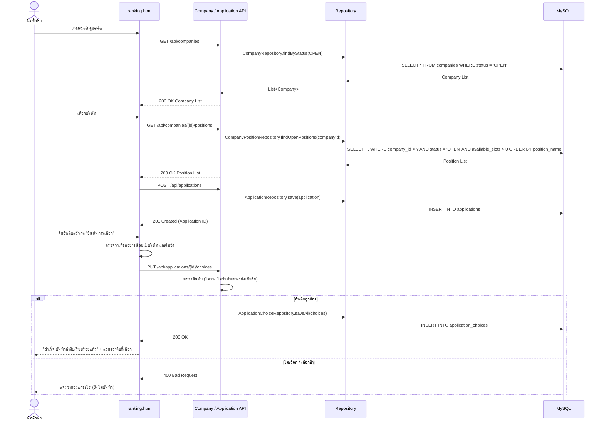
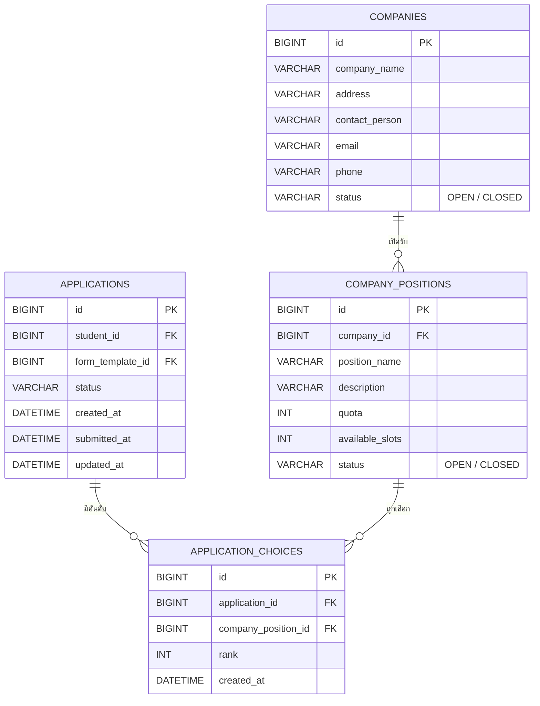

U4:T6 : Design Interaction ระหว่าง API–DAO–DB (ระบบจับคู่บริษัท (จัดอันดับ))
-
User story U4: นักศึกษาที่มีสิทธิ์ไปฝึกสหกิจเลือกบริษัทที่สนใจและจัดอันดับจากรายชื่อที่คณะเปิดรับ

ออกแบบลำดับการทำงานและการเชื่อมต่อระหว่าง API, DAO (Data Access Object) และฐานข้อมูลของระบบจับคู่บริษัท (จัดอันดับ) เพื่อให้ดึง / บันทึกข้อมูลได้ถูกต้อง

ส่วนประกอบของระบบ
-
Controller → Service / Business Logic → DAO / Repository → Entity / ORM → Database

| ส่วนประกอบ | หน้าที่ |
|---|---|
| UI (`ranking.html`) | แสดงบริษัทและตำแหน่งที่เปิดรับ ให้นักศึกษาจัดอันดับและยืนยัน |
| Company API | `GET /api/companies`, `GET /api/companies/{id}/positions` |
| Application API | `POST /api/applications`, `PUT /api/applications/{id}/choices` |
| `CompanyRepository` | ดึงบริษัทตามสถานะ |
| `CompanyPositionRepository` | ดึงตำแหน่งที่เปิดรับและยังมีที่ว่าง |
| `ApplicationRepository` | ค้นหา / บันทึกใบสมัครของนักศึกษา |
| `ApplicationChoiceRepository` | บันทึกและดึงอันดับบริษัทที่นักศึกษาเลือก |
| MySQL | ตาราง `companies`, `company_positions`, `applications`, `application_choices` |

Sequence Diagram
-

- **ดูบริษัท**: ได้เฉพาะบริษัท `OPEN` · ไม่มีบริษัทเปิดรับได้ list ว่าง
- **ดูตำแหน่ง**: ได้เฉพาะตำแหน่ง `OPEN` ที่ `availableSlots > 0` ของบริษัทนั้น เรียงตาม `positionName` · `companyId` ที่ไม่มีในระบบได้ list ว่าง
- **บันทึกอันดับ**: บันทึกลง `application_choices` ผูกกับ `applications.id` · ไม่เลือกหรือเลือกซ้ำต้องไม่บันทึก

DAO class diagram
-

| Repository | Method | หน้าที่ใน U4 | สถานะในโค้ด |
|---|---|---|---|
| `CompanyRepository` | `findByStatus(status)` | ดึงบริษัทที่เปิดรับ (`GET /api/companies`) | มีแล้ว |
| `CompanyRepository` | `findByCompanyNameContainingIgnoreCase(keyword)` | ค้นหาบริษัทจากชื่อ | มีแล้ว |
| `CompanyPositionRepository` | `findByCompanyId(companyId)` | ดึงทุกตำแหน่งของบริษัท | มีแล้ว |
| `CompanyPositionRepository` | `findOpenPositions(companyId)` | ดึงตำแหน่งที่เปิดรับและยังมีที่ว่าง | มีแล้ว |
| `ApplicationRepository` | `findByStudentId`, `findById`, `save` | ใบสมัครของนักศึกษา (ใช้ร่วมกับ U3 / U5) | มีแล้ว |
| `ApplicationChoiceRepository` | `findByApplicationIdOrderByRankAsc(applicationId)`, `saveAll` | ดึง / บันทึกอันดับที่เลือก | ยังไม่มี |

Entity class
-
 

ER diagram
-

- `company_positions.company_id` อ้างอิง `companies.id` (1 บริษัทมีหลายตำแหน่ง)
- `application_choices.application_id` อ้างอิง `applications.id` · `company_position_id` อ้างอิง `company_positions.id`
- 1 ใบสมัครมีหลายอันดับ · `rank` ใน 1 ใบสมัครต้องไม่ซ้ำ และตำแหน่งเดียวกันเลือกซ้ำไม่ได้
- ตาราง `applications` ใช้ร่วมกับ U3 (ยื่นคำร้อง) และ U5 (พิจารณาคำร้อง)

หมายเหตุ
-
- ตอนนี้ในโค้ดมี Entity / Repository ของ `Company` และ `CompanyPosition` แล้ว แต่ยังไม่มี Controller ของ `/api/companies` และยังไม่มี `ApplicationChoice` / `ApplicationChoiceRepository` ต้องพัฒนาให้ครบก่อนรัน T17–T20
